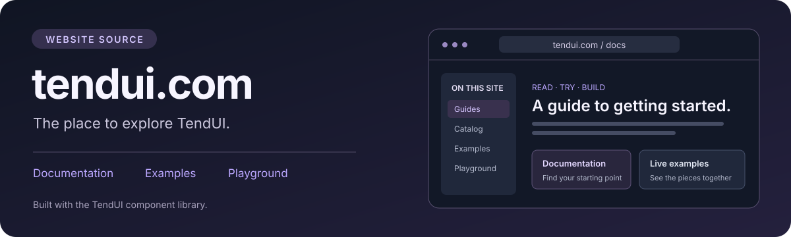

<a href="https://tendui.com">
  
</a>

# tendui.com · Website source

> **Looking for the component library?** Go to **[TendUI →](https://github.com/Tend-Stack/TendUI)** for installation, components, CSS and library contributions.

This repository builds and serves **[tendui.com](https://tendui.com)**: the public
documentation, component catalog, examples and playground for
[TendUI](https://github.com/Tend-Stack/TendUI). It is the website application;
it consumes a pinned release of the component library.

[Visit the website](https://tendui.com) · [Read the guides](https://tendui.com/docs) · [Explore the catalog](https://tendui.com/catalog)

## Work on the website

Use this repository for guide content, website navigation, site styling,
metadata, accessibility and deployment. Report website issues here. For component
behavior, CSS tokens, Go APIs or new components, use the
[TendUI library repository](https://github.com/Tend-Stack/TendUI).

| Website area | Where to work |
| --- | --- |
| Guides and navigation | `content/`, `docs.go`, `docs.templ` |
| Homepage and shared header | `landing.templ`, `site_header.templ` |
| Website styles and artwork | `static/` |
| Routing, assets and metadata | `main.go`, `assets.go` |
| Library version used by the site | `library-version.json`, `go.mod`, `go.sum`, `vendor/` |

The catalog and runnable demos come from the library's example handler. Make
changes to those components in [TendUI](https://github.com/Tend-Stack/TendUI),
then update the website's pinned dependency.

## Run this site locally

Requires Go 1.26 or newer. Dependencies and generated templ output are committed;
normal builds need no Node.js, npm or template generation.

```sh
go run .
# Open http://localhost:8080
```

`PORT` defaults to `8080`. Styles, images and guide content are embedded in the
website binary. No database or runtime asset downloads are required.

```sh
go test -race ./...
go vet ./...
```

Template authors use the generator version recorded in `go.mod`. Browser test
tooling is development-only; see [CONTRIBUTING.md](CONTRIBUTING.md).

## Maintain and deploy

[Website maintenance guide](docs/maintaining-website.md) covers the pinned library,
Docker/Tend deployment, health probes, version metadata, proxy behavior and cache
policy. The repository-root `Dockerfile` builds the website application.

## Contribute to the site

Read [CONTRIBUTING.md](CONTRIBUTING.md), [AGENTS.md](AGENTS.md) and the
[code of conduct](CODE_OF_CONDUCT.md). Website contributions use MIT + DCO;
report vulnerabilities privately through [SECURITY.md](SECURITY.md).

For a project that **uses the component library**, start with
[TendUI](https://github.com/Tend-Stack/TendUI) and its
[application agent guide](https://github.com/Tend-Stack/TendUI/blob/main/docs/agents.md).

[MIT license](LICENSE) · [Website artwork provenance](docs/brand/README.md)
